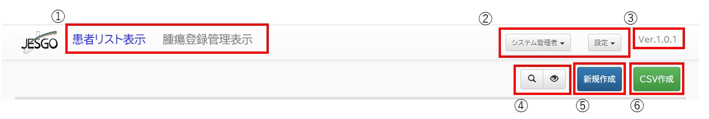
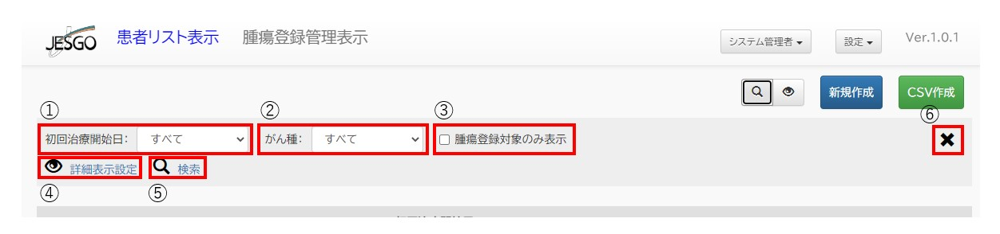
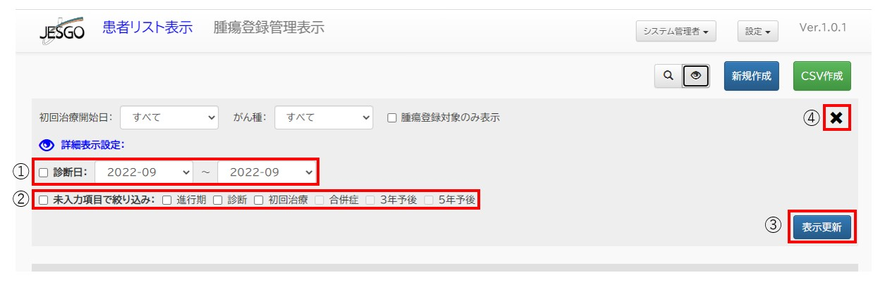
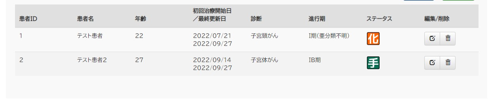
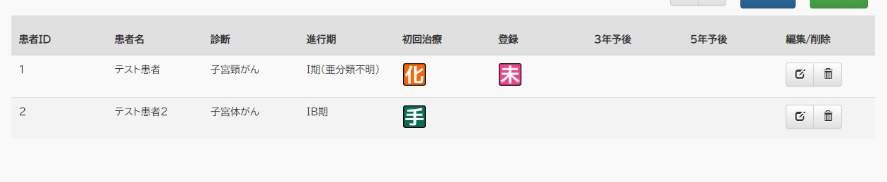

<style>
BODY {
    font-family: 'BIZ UDPMincho', serif;
}
</style>

# 婦人科悪性腫瘍総合入力システム(JESGO)<br/>患者リスト表示仕様書

<table style="margin-top: 5rem; margin-left: auto; margin-right: auto;">
<tr><td>初版(1.0)</td><td>2022-09-28 小坂</td></tr>
</table>

## 1. 履歴

### Version 1.0 初版

## 2. 画面図

### 2.1. 共通部

#### 2.1.1. ヘッダ



1. リスト表示切替
   症例レコードの表示形式を切り替える。現在選択中の表示形式が青字で表示される。
   各表示形式の詳細は後述。
   初期表示は「患者リスト表示」とする。

2. ユーザメニュー、管理メニュー
   ユーザメニュー部にはログインしているユーザの名称が表示される。
   クリックすることで、パスワードの変更、ログアウトが行える。
   管理メニュー部には権限に応じて「利用者管理」、「スキーマ管理」、「システム設定」の 3 つが表示される。
   押下することでそれぞれの管理画面に遷移する。

3. バージョン表示
   現在使用している JESGO のバージョンが表示される。

4. 検索切替
   虫眼鏡のマークを押下すると検索メニューが表示される。
   眼のマークを押下すると詳細表示設定メニューが表示される
   両メニューに関しては後述。

5. 新規作成ボタン
   ボタンを押下すると症例入力画面へ遷移する。

6. CSV 作成ボタン
   ボタンを押下すると現在リストに表示されている患者の一覧を CSV でダウンロードできる。
   内容は患者リスト表示、腫瘍登録管理表示共通で、それぞれに表示されている内容が含まれる。
   ファイル名には現在の年月日時刻を使用し、いつ出力したものかを分かるようにする。

7. プラグイン選択
   全患者を対象とするプラグイン（およびプラグイングループ）が並び、選択すると実行する。
   出力系のプラグインに渡す症例の範囲は「2.4. プラグイン選択から実行したときの対象」を参照。

#### 2.1.2. 検索メニュー



1. 初回治療開始日
   初回治療開始日の検索条件を設定する。
   選択肢はすべて(初期選択)、現在の年から過去 2 年までの 3 年分とする。

2. がん種
   がん種の検索条件を設定する。
   がん種の選択肢はすべて(初期選択)と、スキーマ上で cancer_major, cancer_minor のタグが付けられているものとする。
   cancer_major 由来の物を優先的に上位に表示する。

3. 腫瘍登録対象のみ表示
   チェックボックスをいれて検索すると登録拒否に設定されている症例を表示しない。

4. 詳細表示設定
   押下すると詳細表示メニューを表示する。

5. 検索
   押下すると指定した条件に従い検索、表示の更新を行う。

6. 閉じるボタン
   押下すると検索メニューを閉じる。

#### 2.1.3. 詳細表示メニュー



1. 診断日
   チェックボックスにチェックをいれ、選択肢を指定して表示更新すると診断日がその期間に含まれている症例のみを表示する。
   選択肢は現在の月から過去 11 か月までの 12 か月分とする。

2. 未入力項目で絞り込み
   一番左のチェックボックスにチェックをいれ、各項目のチェックボックスにチェックをいれて表示更新するとその項目が未入力である症例のみを表示する。
   項目は進行期、診断、初回治療のみとし、合併症、3 年予後、5 年予後の項目は現在指定不可とする。

3. 表示更新
   押下すると指定した条件に従い検索、表示の更新を行う。
   その際、詳細表示メニューのみではなく検索メニューの選択も加味した上での検索を行う。

4. 閉じるボタン
   押下すると検索メニュー、詳細表示メニューの両方を閉じる。

### 2.2. リスト表示部

#### 2.2.1. 患者リスト表示


表示項目は後述

#### 2.2.2. 腫瘍登録管理表示


表示項目は後述

#### 2.2.3. 共通表示項目

1. 患者 ID
   症例に設定されている患者 ID を表示する。

2. 患者名
   患者氏名をフルネームで表示する。

3. 診断
   cancer_major, cancer_minor のタグが設定された項目の内容を表示する。
   複数ある場合は cancer_major の項目を上位にすべて表示を行う。

4. 進行期
   figo のタグが付けられている項目の入力内容を表示する。
   複数ある場合は複数表示する。

5. 編集/削除ボタン
   該当の症例の編集、削除を行う。
   それぞれログイン中のユーザに権限があるときにのみ表示される。

6. 背景色
   死亡済の症例は行背景をダークグレーで表示する。

#### 2.2.4. 患者リストのみの表示

1. 年齢
   生年月日と現在日時から算出した現在の年齢を表示する。
   対象症例が死亡済の場合、死亡日時の年齢を表示する。

2. 初回治療開始日／最終更新日

   - 初回治療開始日
     initial_treatment_date のタグが設定された項目の日付を表示する。
     複数の項目がある場合、一番早い日付を表示する。

   - 最終更新日
     該当の症例で最後に登録、更新のあった日付を表示する。

3. ステータス
   症例の保有する状態により複数の項目を表示する。

- 「死亡」：患者が死亡していることを表す。死亡日が設定されている際に表示される。
- 「手」：手術療法を行っていることを表す。treatment_surgery のタグが付いた項目が入力されている際に表示される。
- 「化」：化学療法を行っていることを表す。treatment_chemo のタグが付いた項目が入力されている際に表示される。
- 「放」：放射線療法を行っていることを表す。treatment_radio のタグが付いた項目が入力されている際に表示される。
- 「緩和」：緩和療法を行っていることを表す。treatment_supportivecare のタグが付いた項目が入力されている際に表示される。
- 「再発」：再発が起きていることを表す。recurrence のタグが付いたドキュメントが存在している際に表示される。

#### 2.2.5. 腫瘍登録管理のみの表示

1. 初回治療
   初回治療に使用した療法をアイコンであらわす。
   treatment_surgery, treatment_chemo, treatment_radio, treatment_supportivecare いずれかのタグが含まれている項目が入力されていて、
   かつ再発指定の項目でない場合それらのアイコンを表示する。
   複数存在する場合、すべて表示を行う。

2. 登録
   症例に登録拒否が設定されている場合は最優先で「拒否」を表示する。
   registrability のタグが付いている項目が「はい」且つ、registration_number のタグが付いている項目が入力されている場合、「済」を表示する。
   registrability のタグが付いている項目が「はい」且つ、registration_number のタグが付いている項目が入力されていない場合、「未」を表示する。
   複数の条件が成り立つ場合、「拒否」>「未」>「済」の優先順で 1 つのみ表示を行う。

   **「警告あり」「エラーあり」の印（文書のエラー情報 jesgo:error による）**
   文書のエラー情報（プラグインなどが文書に書き込む `jesgo:error`）から、次のとおり印を付ける。文書は読むだけで変更しない。
   - 要素が文字列の場合: 「要確認」を含めば「警告あり」、「要修正」を含めば「エラーあり」を付ける。
   - 要素が `{ "項目名": "文字列" }` の形の場合: 値の文字列それぞれに、文字列と同じ規則を当てはめる。
   - 要素が `null` の場合: 判定に使わない。
   - 上記以外の読み取れない値がある場合（数値・真偽値・配列の入れ子・値に文字列以外を含むオブジェクト、または `jesgo:error` 自体が配列でない場合）: その文書に「エラーあり」を付ける。エラー情報が読めないことを、エラーが無いことと取り違えないためである。症例を開いて確かめる。
   - `jesgo:error` が無い・`null`・空の配列の場合: 印を付けない。

   読み取れない値を含む文書があっても、一覧（両表示形式）・CSV 作成・プラグインの対象集めは止まらない。その症例の他の列、同じ症例の他の文書、他の症例の印は影響を受けない。
   読み取れない値を見つけた場合は、運用ログ（WARN）に文書の ID を記録する（患者 ID・氏名・エラー情報の中身は記録しない）。

3. 3 年予後
   three_year_prognosis を含むドキュメントが登録されており、かつ該当の項目が入力済であれば「済」を表示する。
   three_year_prognosis を含むドキュメントが登録されており、かつ該当の項目が未入力であれば「未」を表示する。
   ただし、初回治療日が未指定か、初回治療日から 3 年がたっていない場合、何も表示しない。
   「未」と「済」の両方の条件が成り立つ場合、「未」>「済」の優先順で 1 つのみ表示を行う。

4. 5 年予後
   five_year_prognosis を含むドキュメントが登録されており、かつ該当の項目が入力済であれば「済」を表示する。
   five_year_prognosis を含むドキュメントが登録されており、かつ該当の項目が未入力であれば「未」を表示する。
   ただし、初回治療日が未指定か、初回治療日から 3 年がたっていない場合、何も表示しない。
   「未」と「済」の両方の条件が成り立つ場合、「未」>「済」の優先順で 1 つのみ表示を行う。

### 2.3. 検索・絞り込みの状態の維持と表示の初期化

#### 2.3.1. 一覧へ戻ったときの維持

患者リストから症例入力画面や管理画面へ移り、患者リストへ戻ったときは、離れる直前と同じ条件で一覧を表示する。
一覧は戻るたびに、その条件で最新の内容を取得し直す（症例を保存して戻った場合は、保存後の内容で表示される）。
保持するのは条件だけで、一覧の内容（患者名・患者 ID など）は保持しない。

1. 対象となる戻り方
   次のいずれの戻り方でも同じく維持する。
   - 症例入力画面の「保存してリストに戻る」「保存せずリストに戻る」
   - 症例の読み込みに失敗したときの自動の戻り
   - 新規作成から戻る
   - 管理画面（利用者管理、スキーマ管理、プラグイン管理、プリセット管理、システム設定、患者リストプリセット管理）からの戻り
   - 症例入力画面などからブラウザの「戻る」で患者リストに着いた場合

2. 維持する項目
   - 表示形式（患者リスト表示／腫瘍登録管理表示）
   - 検索メニューの条件（初回治療開始日、がん種、腫瘍登録対象のみ表示、患者リスト表示の未入力項目で絞り込み）
   - 詳細表示メニューの条件（腫瘍登録管理表示: 診断日、イベント日、未入力項目で絞り込み／患者リスト表示: プリセット項目の絞り込み）
   - 並び順、ページ、表示件数
   - プリセット表示／通常表示
   - 検索メニュー・詳細表示メニューの開閉
   一覧のスクロール位置は維持しない（一覧の先頭を表示する）。

3. 2 つの表示形式の条件
   検索メニューの初回治療開始日・がん種・腫瘍登録対象のみ表示は、患者リスト表示と腫瘍登録管理表示で共通とする。
   表示形式を切り替えると、これらの条件はそのまま引き継がれ、切り替え後の一覧もその条件で表示される。
   詳細表示メニューの条件と未入力項目で絞り込みは、表示形式ごとに保持する。

4. ページ
   離れる直前のページが、戻ったときの一覧に存在しない場合（保存により該当件数が減った場合など）は、存在する最後のページを表示する。

5. プリセット
   患者リストプリセット管理で別のプリセットを選んで表示した場合は、プリセット項目の絞り込み、並び順、ページを初期状態に戻す（その他の条件は維持する）。
   選択したプリセットは、従来どおりログアウト後も同じブラウザに保持される。

#### 2.3.2. 維持の期間

- 画面の再読み込み（患者リスト、症例入力画面のいずれで行った場合も）では維持する。
- ログイン画面を経由した場合（ログアウト、別の利用者でのログイン、同じ利用者の再ログイン、セッション切れ後のログイン）は維持せず、初期表示とする。前の利用者の条件が次の利用者に引き継がれることはない。
- ブラウザのタブ（ウィンドウ）を閉じると維持しない。別のタブで開いた患者リストは初期表示から始まり、タブごとに独立する。

#### 2.3.3. 絞り込み中の表示

一覧に初期表示と異なる絞り込みが効いているときは、画面上部のボタン列の左に「検索条件で絞り込み中（がん種・初回治療開始日 など）」と、効いている条件の名称を表示する。
また、一覧下部の件数表示の横に「（絞り込み中）」と表示する。
表示は一覧の取得に実際に使った条件に基づく（入力欄を変更しただけで「検索」「表示更新」を押していない条件は含まない）。

#### 2.3.4. 表示の初期化

画面上部のボタン列の「表示の初期化」を押下すると、確認なしで次の状態に戻し、一覧を取得し直す。
症例データは変更しない。

- 検索メニュー・詳細表示メニューの条件、プリセット項目の絞り込み: 初期表示と同じ（条件なし）
- 並び順: なし
- ページ: 1 ページ目
- 表示件数: システム設定の初期表示件数
- 検索メニュー・詳細表示メニュー: 閉じる

表示形式（患者リスト表示／腫瘍登録管理表示）とプリセットの選択は変更しない。

#### 2.3.5. 条件リセット

検索メニューの「条件リセット」、詳細表示メニューの「条件リセット」は、入力欄の値を初期値に戻すだけで、一覧は取得し直さない（「検索」「表示更新」を押下すると、戻した条件で一覧を表示する）。
一覧も含めて初期表示に戻す場合は「表示の初期化」を使用する。

### 2.4. プラグイン選択から実行したときの対象

#### 2.4.1. 出力系のプラグイン（データを出力するプラグイン）

ヘッダの「プラグイン選択」（プラグイングループのダイアログから実行した場合も同じ）から出力系のプラグインを実行すると、**実行した時点の一覧の全件**をプラグインに渡す。

1. 対象の範囲
   - 一覧の取得に実際に使った検索・絞り込みの条件に合う全件とする。条件が無ければ全患者（削除されていない全症例）となる。
   - 表示中のページ・表示件数には左右されない（2 ページ目以降の症例も含む）。
   - 患者リスト表示では、詳細表示メニューのプリセット項目の絞り込みも反映する。対象の件数は一覧下部の件数表示と一致する。
   - 腫瘍登録管理表示では、腫瘍登録管理表示の条件（診断日、イベント日、未入力項目で絞り込みを含む）で絞り込んだ全件とする。
   - 入力欄を変更しただけで「検索」「表示更新」を押していない条件は含まない。別の表示形式で前に表示した一覧が対象になることもない。
   - プラグインに渡す症例の一覧の順序は、一覧の並び順と同じとする（ページの区切りに関係なく、全体を通した順序）。
     ただし、プラグインが症例の文書をまとめて取得したときの文書の並びは、従来どおりサーバが返す順序となる。

2. 実行前の確認
   出力系のプラグインを実行する前に、毎回、対象の症例の件数と、一覧が絞り込み中かどうかを示す確認を 1 回だけ表示する。
   出力結果に患者情報を含むプラグインでは、患者情報を含む旨もこの確認の中で示し、別の確認は表示しない。
   「キャンセル」を押下した場合はプラグインを実行しない。

   ```
   プラグイン「（プラグイン名）」を実行します。

   対象の症例：（件数）件
   一覧の絞り込み：（なし／絞り込み中（絞り込みの名前））
   （注記がある場合はここに表示する）

   出力結果に患者情報が含まれています、実行しますか？
   ```

   - 件数は 3 桁区切りで表示する（例:「10,021件」）。
   - 最後の行は、出力結果に患者情報を含むプラグインでは「出力結果に患者情報が含まれています、実行しますか？」、含まないプラグインでは「実行しますか？」とする。患者情報を含むかどうかの条件は従来と同じ。
   - 一覧が絞り込み中の場合は「※ 絞り込まれた一覧の症例だけが対象になります。」を表示する。
   - 確認に示す件数が一覧の件数表示と異なる場合は、その理由を表示する。
     - カスタムプリセットの患者リスト表示で、1 つの症例が複数の行に表示されている場合（件数表示は行数、対象は症例の件数）
     - 一覧を表示した後に、症例が追加・削除・更新された場合（対象は実行した時点の最新の内容で決まる）

   症例画面から実行するプラグインの確認（患者情報の確認を含む）と、一括更新系・新規登録系のプラグインの確認は従来どおりとする（一括更新系・新規登録系では、この確認は表示しない。2.4.2 を参照）。

3. 対象が無い場合
   次の場合はプラグインを実行せず、「対象の症例がありません。」と表示する。
   - 一覧が 0 件のとき
   - 一覧の読み込みが完了していないとき
   - 一覧の取得に失敗しているとき、または対象の症例の取得に失敗したとき（失敗したことも併せて表示する）

4. 件数が多い場合
   件数の上限は設けない。
   プラグインの実行中に症例の文書の取得に失敗した場合は、一部の症例だけで作られた結果になるおそれがあるため、エラーを表示し、出力結果は表示しない。
   プラグインの実行には従来どおり時間切れ（900 秒）があり、時間切れの場合は「操作がタイムアウトしました」と表示する。

5. 渡す情報
   1 症例あたりに渡す情報、患者情報を含まないプラグインへ渡すときに氏名・患者 ID などを除く処理、権限の確認は従来どおりとする。
   なお、症例に文書が 1 つも無い場合は、従来どおりプラグインが受け取る文書の一覧には含まれない（プラグインが表示する件数が一覧の件数より少なくなることがある）。

#### 2.4.2. 一括更新系・新規登録系のプラグイン

全患者対象でデータを更新するプラグイン（一括更新系）は、次の 3 種類に分かれる。対象の決め方は種類ごとに異なる。

| 種類 | 見分け方（プラグイン情報） | 例 | 対象 |
|------|----------------------------|----|------|
| ロジカルチェック | 新規登録系でなく、ファイルを読み込まない（アップロードダイアログを表示しない） | 腫瘍登録スクリプト一括実行 | 実行した時点の一覧の症例（下記） |
| ファイルを読み込む更新系 | ファイルを読み込む（アップロードダイアログを表示する） | 腫瘍登録番号のインポート | 従来どおり。ファイルの内容で決まる（一覧の検索・絞り込みに関係しない） |
| 新規登録系 | プラグインの初期化で新規登録（newdata）を示す | 患者データ一括取込 | 従来どおり。一覧を使わない |

ロジカルチェックかどうかは、プラグイン情報（全患者対象・データ更新・新規登録系でない・ファイルを読み込まない）で判定する。プラグインの名前・説明文・番号では判定しない。

1. ロジカルチェックの対象の範囲
   - ロジカルチェックのプラグインには、**実行した時点の一覧の症例の文書だけ**を渡す。一覧の範囲は出力系（2.4.1 の 1.）と同じであり、表示中のページ・表示件数・並び順には左右されない。
   - 検索・絞り込みをしていない一覧から実行した場合は、一覧の全件（削除されていない全症例）が対象となる。全症例をチェックするには、絞り込みを外してから実行する。
   - 対象スキーマの指定があるプラグインでは、一覧の症例のうちそのスキーマの文書だけを渡す（従来の対象スキーマの扱いと同じ）。
   - プラグインに渡す文書の並びは、従来どおりサーバが返す順序とする。
   - 腫瘍登録スクリプト一括実行が表示する「読み込まれた症例数は N 症例です.」の N は、一覧の症例のうち文書のある症例の数となる。腫瘍登録用 CSV の出力などのモードも、同じく一覧の症例が対象となる。

2. 実行前の確認
   ロジカルチェックのプラグインでは、本体の確認（件数の確認など）は表示しない。従来どおり、選択するとすぐにプラグインのダイアログが開く。
   プラグインのダイアログで「実行」を押す前に閉じた場合は、文書は書き換わらない。上書き確認・上書きのログは従来どおりとする。

3. 対象が無い場合
   次の場合はプラグインを実行せず（プラグインのダイアログも開かず）、「対象の症例がありません。」と表示する。全症例を対象にして実行することはない。
   - 一覧が 0 件のとき
   - 一覧の読み込みが完了していないとき
   - 一覧の取得に失敗しているとき、または対象の症例・文書の取得に失敗したとき（失敗したことも併せて表示する）

4. 対象外の症例への更新
   プラグインが、一覧に含まれない症例への更新（症例番号・ハッシュ・腫瘍登録番号・文書番号のいずれの指定でも）や、一覧に含まれない症例の文書の取得を返した場合は、本体は適用しない。
   適用しなかった件数を利用者に表示し、運用ログに残す（患者 ID・氏名・エラー情報の中身は出さない）。一覧の症例への更新は従来どおり適用する。
   対象外の症例のエラー情報は、前回の実行結果のまま残る。

5. その他
   - 一括更新系のプラグインの実行には、従来どおりプラグインデータ更新権限が必要であり、時間切れ（900 秒）の扱いも従来どおりとする。
   - 一括更新系のプラグインの実行後は、表示中の表示形式・条件で一覧を取得し直す。

#### 2.4.3. CSV 作成との違い

CSV 作成の対象は変更していない。プラグインの対象とは次の点が異なる。

- CSV 作成は、患者リスト表示のプリセット項目の絞り込みを反映しない（検索メニュー・詳細表示メニューのその他の条件は反映する）。プラグインの対象は反映する。
- CSV 作成は一覧の内容を CSV の行として出力する（プリセット表示では、1 つの症例が複数の行になることがある）。プラグインの対象は症例単位である。
